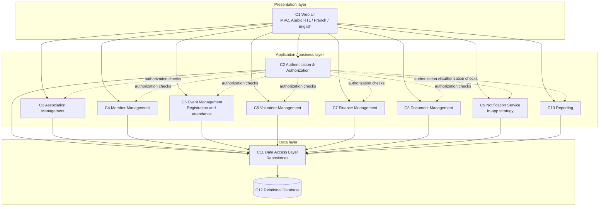

# Architecture

> Living design baseline for Jamiya. Update this document when the implementation
> or confirmed requirements change. Unresolved proposals are listed separately
> from the agreed baseline.

## 1. Overview

Jamiya is planned as a web platform for multiple Tunisian associations. It uses an Agile, iterative delivery process and object-oriented design within a layered, three-tier modular monolith. The presentation layer contains the responsive, multilingual web UI and uses MVC; business services implement workflows and authorization; repositories isolate persistence in the data-access layer; and a relational database stores application data. Requests flow from the UI through business services and repositories to the database. Association-scoped authorization and data access must prevent one association from accessing another association's records.

The selected implementation stack is React with TypeScript and Vite for the web interface, a NestJS API written in TypeScript, Prisma for data access, and PostgreSQL for relational storage. The workspaces use Node.js 24 LTS and npm. Frontend tests use Vitest; API tests use Jest. The deployment platform remains undecided. The SRS is unavailable, so requirement IDs and unconfirmed details in the supplied Lab 4 and Lab 5 designs remain proposals unless explicitly agreed in the project baseline.

## 2. Component diagram

The twelve components below follow the Lab 5 design. No external notification provider is in the current baseline; in-app notifications are stored as application data.

| Component | Responsibility |
|-----------|----------------|
| C1 Web UI | Forms, lists, dashboards, navigation, and Arabic/French/English presentation, including RTL for Arabic. Contains no business rules. |
| C2 Authentication & Authorization | Authentication, account/password management, role checks, and association-scoped access control. Authorization is enforced server-side. |
| C3 Association Management | Association profile, association users, and association dashboard data. |
| C4 Member Management | Member records, search, membership status and dates, and member workflows. |
| C5 Event Management | Event lifecycle, registration workflow, capacity rules, and attendance. |
| C6 Volunteer Management | Volunteer profiles, opportunities, applications, decisions, and participation tracking. |
| C7 Finance Management | Basic income and expense records and summaries. |
| C8 Document Management | Document metadata, categorization, access control, and upload/download/delete workflows. |
| C9 Notification Service | Announcements and in-app membership, volunteer, and event notifications. Delivery uses an internal strategy abstraction; external channels are not in the baseline. |
| C10 Reporting | Read-oriented member, event, volunteer, and financial statistics and reports. |
| C11 Data Access Layer | Repository implementations; the only component that communicates with the database. |
| C12 Relational Database | Persistent storage for association-scoped application data. |

## 3. Key modules and design boundaries

The implementation should preserve these dependency rules:

- UI controllers and views call business services; UI code does not implement business rules or access persistence directly.
- Business services coordinate use cases and depend on repository abstractions rather than database-specific code.
- Only C11 repositories communicate with C12. Repositories use Prisma for persistence; queries and writes must enforce association boundaries.
- C2 authorization is checked server-side for every protected operation; hiding a UI control is not authorization.
- C9 owns notification dispatch. Member, event, and volunteer workflows must not depend on a concrete delivery channel.
- C10 reporting is read-only and obtains data through repositories rather than querying database tables directly.
- Keep the deployment as one modular application unless confirmed requirements demonstrate a need to split it into services.

The npm workspace contains the React/Vite frontend in `apps/web` and the NestJS API in `apps/api`. The frontend has an authenticated, multilingual member-management screen backed by the API; other dashboard and module content remains illustrative. The API has Prisma/PostgreSQL-backed sessions and member CRUD. Other business modules have not been implemented.

## 4. Domain model and data

The current design baseline includes these domain concepts:

| Entity | Main relationships and responsibility |
|--------|--------------------------------------|
| User | Account and role; belongs to an association. May have an optional Member profile and an optional Volunteer profile. |
| Association | Owns association-scoped members, events, opportunities, documents, and financial transactions. |
| Member | Membership profile and status; belongs to an association and participates in event registrations and attendance. |
| Event | Belongs to an association; has registrations and attendance records. |
| EventRegistration | Connects one member to one event; duplicate event/member registrations are not allowed. |
| Attendance | Records a member's attendance at an event; manual recording is the baseline. |
| Volunteer | Volunteer profile associated with a user; submits applications. |
| VolunteerOpportunity | Belongs to an association and receives volunteer applications. |
| VolunteerApplication | Connects a volunteer to an opportunity and records its decision/status. |
| FinancialTransaction | Association income or expense; may reference a supporting document. |
| Document | Association-owned file metadata, category, storage reference, and access level. |
| Notification | In-app message for a user, including read state. |

The baseline roles are **president**, **administrator**, **treasurer**, **member**, and **volunteer**. A platform-administrator role is not included. Member email is normalized to lowercase and unique within an association. Membership status is stored explicitly as `active`, `pending`, or `expired`; optional start/end dates are informational and do not derive status. Presidents and administrators manage all members in their association, treasurers have read access, and members/volunteers may read only their own linked member profile. Association data must be isolated in storage and every relevant read/write.

Store financial amounts with precision appropriate for Tunisian dinars (three decimal places). Keep uploaded file content outside relational records when appropriate and store a reference in the database; the storage provider/location is undecided.

## 5. Key flows

### Add a member

1. A president or administrator signs in with the association slug, email, and password.
2. C2 validates the opaque session token and obtains the user's association and role from the stored session.
3. The member screen submits through C1 to C4; C2 rejects unauthenticated users and permits writes only for presidents/administrators.
4. C4 validates the name, normalized email, explicit status, and optional date order.
5. C11 queries/writes with the authenticated association id; a database unique constraint and service error handling reject duplicate association/email pairs.
6. C1 reports success or a clear validation, conflict, or authorization error.

Member list/get requests are association-scoped. Treasurers can read all members in their association; member/volunteer users can read only a profile linked to their user account. Member create, update, and delete are restricted to presidents and administrators.

### Register for an event

1. An authenticated member requests registration through C1.
2. C2 verifies access and that the member belongs to the relevant association.
3. RegistrationService coordinates the workflow and asks EventService for the event.
4. The workflow verifies that the event is published and in the future, that the member's membership is active, that the member has not already registered, and that capacity remains.
5. The capacity/duplicate checks and registration write are performed atomically (for example, a database transaction with suitable uniqueness and concurrency protection).
6. C1 reports confirmation or an explanatory error. A failed check must not leave a partial registration.

## 6. Patterns

- **MVC:** separates the web interface's controllers/views from business rules.
- **Repository:** isolates persistence and helps services be tested independently of the database.
- **Strategy:** keeps notification delivery replaceable; the baseline has an in-app strategy only. Email/SMS strategies may be reconsidered later.

Observer, microservices, and an event broker are not part of the current design; introduce them only if later requirements justify their added complexity.

## 7. Quality goals

- **Security:** server-side role and association authorization, password hashing, input validation, protected document access, and parameterized persistence operations.
- **Maintainability and testability:** modular responsibilities, explicit service/repository boundaries, and testable business rules.
- **Usability and localization:** responsive UI in Arabic (RTL), French, and English.
- **Performance and scalability:** indexes and pagination where appropriate; the modular application may be run in multiple instances if needed, sharing the database.
- **Data integrity:** event capacity and duplicate registration constraints remain correct under concurrent requests.

## 8. Outside the current baseline

The following features are deferred, not permanently excluded, and may be reconsidered later:

- Online payments
- Full accounting
- A native mobile application
- QR-code attendance
- Volunteer certificates
- Email or SMS notifications
- AI features

## 9. Open questions and proposals

- The SRS is unavailable. Requirement IDs and unconfirmed use-case priorities from the design documents must be validated if the SRS becomes available.
- Hosting and deployment details remain undecided.
- The account invitation/provisioning workflow for administrators, treasurers, members, and volunteers needs definition; the current seed creates only the first president account.
- Password reset, login rate limiting, and production session/cookie policy require further design before deployment.
- The physical document storage location, upload limits, and retention policy need to be selected.
- Tenant isolation must be enforced consistently, including for records such as event registrations and attendance that can derive association ownership through their related event/member.
- Volunteer participation tracking needs a concrete lifecycle/data representation if required by the final requirements.
